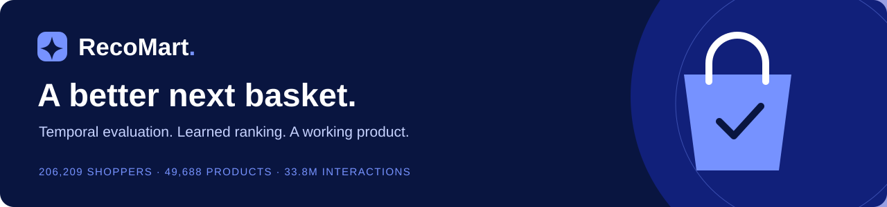
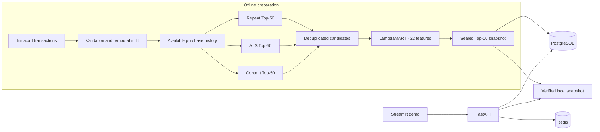

# RecoMart



**An end-to-end grocery recommender that turns purchase history into a ranked next-basket shortlist.**

RecoMart combines temporal data engineering, candidate retrieval, learned ranking, and a working FastAPI + Streamlit application. Built on the Instacart Market Basket Analysis dataset, it follows one rule: **every additional model must earn its complexity.**

[Results](#final-test-results) · [Architecture](#architecture) · [Run locally](#run-locally) · [Demo](#the-demo) · [Documentation](#documentation)

## At a glance

| | Current state |
|---|---|
| Selected model | Repeat Purchase + ALS + Content → LambdaMART |
| Final-test Recall@10 | **0.354376**; **+6.86% relative** to repeat purchase |
| Scale | **206,209 shoppers**, **49,688 products**, **33.8 million known interactions** |
| Serving | FastAPI, versioned PostgreSQL snapshots, Redis caching, local outage fallback |
| Interface | Responsive Streamlit demo with recommendations, catalog search, saved lists, and model results |
| Verification | **135 tests passed**, including six live PostgreSQL tests; **99 sealed artifacts** |
| Status | Offline evaluation and local application complete; deployment and monitoring are next |

## The problem

Grocery shopping is heavily habitual: a customer's usual milk, bread, or coffee is a strong prediction for the next order. That makes repeat purchase a demanding baseline. More sophisticated retrieval helps only when the final ranking turns those candidates into better recommendations.

RecoMart predicts **ten products for a customer's next basket**. It measures next-basket accuracy separately from novel-item discovery, uses chronological splits, and keeps the selected architecture fixed before final-test access.

## Final-test results

All six policies were evaluated on the same **206,209 users** and **2,165,417 held-out interactions**. These are final-test results, not the earlier development benchmarks.

| Policy | Recall@10 | Precision@10 | NDCG@10 | Hit Rate@10 |
|---|---:|---:|---:|---:|
| Global popularity | 0.069942 | 0.072112 | 0.097616 | 0.457027 |
| Repeat purchase | 0.331622 | 0.275896 | 0.399060 | 0.856364 |
| Repeat + popularity fill | 0.332535 | 0.276296 | 0.399533 | 0.857625 |
| ALS v2 | 0.154914 | 0.123481 | 0.177601 | 0.648100 |
| Content v1 | 0.084644 | 0.074875 | 0.102998 | 0.475241 |
| **Selected LambdaMART** | **0.354376** | **0.296722** | **0.426033** | **0.872620** |

The selected model improves recall by **6.86% relative to repeat purchase** and **6.57% relative to repeat with popularity filling**. It returns ten unique products for every evaluated user and reaches **70.15% of the 49,668 products observed in prediction history**.

**The trade-off:** conditional novel-item Recall@10 is only **0.002737**. The selected system prioritizes next-basket accuracy; it does not solve discovery. Offline accuracy improvements are not measurements of sales, conversion, or customer satisfaction.

- **Recall:** fraction of the actual next basket recovered by the recommendations.
- **Precision:** relevant products among the ten requested recommendations.
- **NDCG:** rewards placing relevant products nearer the top.
- **Hit rate:** fraction of users with at least one relevant recommendation.

Metrics are macro averages over users. Precision divides by ten even for a short baseline list. See the [full evaluation and segment results](docs/final_test.md), [JSON benchmark](results/benchmarks/final_test_v1.json), [CSV summary](results/benchmarks/final_test_v1.csv), and [independent audit](results/benchmarks/final_test_v1_audit.json).

## Architecture



### Ranking decisions

The final model uses **486 boosting rounds** and 22 features covering retrieval rank, source membership, purchase frequency, recency, reorder behavior, popularity, and category affinity. Up to 50 candidates per source are combined before ranking.

The research path matters as much as the final model:

| Experiment | What it established | Final decision |
|---|---|---|
| Repeat-purchase baseline | Shopping habits are a strong next-basket signal. | Keep as a source and availability fallback. |
| ALS and content retrieval | Complementary candidates improve the learned ranker. | Keep both sources. |
| Two-Tower v1/v2 | More candidate coverage did not yield a material Top-10 gain under the declared selection tolerance. | Retain the experiments; exclude neural retrieval from serving. |
| Forced discovery slots | More novel recommendations came with lower overall accuracy. | No forced novelty quota. |
| Dedicated novel-item ranker | Did not demonstrate an improvement over the matched one-slot policy. | Do not add another serving model. |
| Aisle caps | Increased category diversity while reducing accuracy. | No mandatory aisle cap. |

The three-source model met the predeclared **0.001 absolute Recall/NDCG tolerance** against the more complex alternatives, using paired confidence bounds on the same 41,114 development users. This was a measured complexity trade-off, not a claim that the models were identical. [Architecture decision and evidence →](docs/final_architecture.md)

### Serving behavior

Recommendations are **precomputed**, not ranked online. A request checks the snapshot-scoped Redis cache, then PostgreSQL, then the verified local snapshot if a backend is unavailable. The full local snapshot remains in memory for integrity checks and availability.

| Situation | Behavior |
|---|---|
| Known shopper with a ranked list | Preserve the evaluated ranking. |
| Partial ranked list | Fill with unique popular products. |
| Ranked list unavailable | Use repeat purchases, then popularity filling. |
| Unknown shopper | Return global popularity. |
| Redis/PostgreSQL outage after startup | Continue from available backends or the sealed local snapshot; report degraded health. |
| Corrupt required local artifact | Abort startup. |

Redis keys include the snapshot hash, shopper bucket, and requested K. PostgreSQL publication is transactional and versioned. Cached rankings and database responses are validated against the snapshot. A configured PostgreSQL backend must contain the matching snapshot at API startup. [Storage, caching, and outage tests →](docs/database_cache.md)

## The demo

The interface uses **navy `#091540`**, **blue `#1B2CC1`**, and **periwinkle `#7692FF`**, with local category illustrations and a layout checked at desktop and phone widths.

| View | What you can do |
|---|---|
| **For you** | Choose a shopper, view ranked recommendations and recurring favorites, or try the new-shopper fallback. |
| **Explore catalog** | Search names and categories, filter departments, page through products, and browse the same aisle. |
| **Saved list** | Save/remove products for each shopper and export a CSV shopping list. |
| **Model report** | Compare six final-test policies and switch between ranking metrics. |

The UI includes loading, empty, degraded-service, and retry states. Saved lists last for the current Streamlit session and can be downloaded. Recurring favorites are a summary, not complete order history; same-aisle browsing is not learned item similarity. Product art represents categories, and there are no live prices or checkout. [Demo guide →](docs/demo.md)

## Run locally

### What a fresh clone includes

This repository contains **source code, tests, frozen configuration, and aggregate benchmark reports**. Raw data, processed data, trained models, the prediction seal, local service credentials, and database files are **not committed**. There is currently no downloadable serving-artifact bundle.

Running the real API requires the matching local serving artifacts listed in the [API guide](docs/serving_api.md#artifact-loading-and-integrity). A fresh clone can run fixture-based tests without the Instacart data; it cannot immediately serve the full catalog. See [data preparation](data/README.md) and the [final-experiment prerequisites](docs/final_test.md#artifacts-and-reproduction) before attempting a rebuild.

### 1. Create the environment

The current environment was verified on **Windows with Python 3.14**. The following commands use PowerShell and run from the repository root:

```powershell
git clone https://github.com/stupidtallguy/recomart-recommender-system.git
cd recomart-recommender-system
py -3.14 -m venv .venv
.\.venv\Scripts\python.exe -m pip install -r requirements-api-lock.txt -r requirements-demo-lock.txt
```

The API and demo do not need Spark, PyTorch, XGBoost, or test labels at runtime. The full project environment uses `requirements-lock.txt`; the neural experiments require a separately configured PyTorch environment. Lock files record the tested Windows/Python environment rather than promising compatibility on every platform.

### 2. Start the API

Once the matching serving artifacts are available, the simplest mode uses the local snapshot:

```powershell
.\.venv\Scripts\python.exe -m uvicorn src.api.main:app --host 127.0.0.1 --port 8000
```

For PostgreSQL and Redis, configure the variables documented in [`.env.example`](.env.example), publish the snapshot, and pass the env file explicitly:

```powershell
.\.venv\Scripts\python.exe -m src.serving.import_snapshot --env-file .env
.\.venv\Scripts\python.exe -m uvicorn src.api.main:app --host 127.0.0.1 --port 8000 --env-file .env
```

These commands assume the database and cache already exist. The [backend guide](docs/database_cache.md) also documents the isolated services prepared on the development machine; its helper is not an installer for a fresh clone.

### 3. Start the demo

In a second terminal, from the same repository root:

```powershell
.\.venv\Scripts\python.exe -m streamlit run demo/app.py
```

Open the local [demo](http://127.0.0.1:8501), [interactive API docs](http://127.0.0.1:8000/docs), or [health endpoint](http://127.0.0.1:8000/health). These URLs work while the local processes are running; they are not a hosted deployment. Set `RECOMART_API_URL` in the demo process environment to use a different API address.

## API

| Endpoint | Purpose |
|---|---|
| `GET /recommendations/{user_id}?k=10` | Ranked product metadata; K from 1 to 10. |
| `GET /products/{product_id}` | One product's catalog details. |
| `GET /users/{user_id}/profile` | Historical order count and repeat-baseline favorites. |
| `GET /catalog` | Product count and department options. |
| `GET /catalog/products` | Search and pagination using `q`, `department`, `offset`, and `limit`. |
| `GET /catalog/products/{product_id}/neighbors` | Up to six products in the same aisle. |
| `GET /health` | Snapshot identity, readiness, backend health, and cache counters. |

```powershell
Invoke-RestMethod 'http://127.0.0.1:8000/recommendations/1?k=3'
```

Recommendation responses include the model version, snapshot hash, fallback strategy, and ordered products. `X-RecoMart-Source` and `X-RecoMart-Cache` headers expose where the response came from. IDs must be positive signed 64-bit integers; invalid inputs return 422 and missing products return 404.

## Evaluation and verification

The data split preserves each user's order chronology:

```text
Older baskets                Second-last basket      Latest basket
TRAIN                        VALIDATION              TEST
29,524,435 interactions       2,129,254 interactions   2,165,417 interactions
```

After development, the frozen ranker recipe was refit using training-history features and validation-basket labels. Prediction history then advanced to **train + validation**. All six policies' predictions were generated and sealed **before** final-test labels were accessed. An independent audit reproduced their core metrics within `1e-12`.

Install the full test environment and run the suite:

```powershell
.\.venv\Scripts\python.exe -m pip install -r requirements-lock.txt
.\.venv\Scripts\python.exe -m pytest tests -q -p no:cacheprovider
```

- **135 tests passed** with `RECOMART_TEST_DATABASE_URL` configured; without it, six database tests explicitly skip.
- Database tests create and remove their own randomly named databases. Use a local test role with database-creation privileges; see the [test setup](docs/database_cache.md#verification).
- [Live API checks](results/benchmarks/demo_api_smoke.json) verify all **206,209 saved rankings** and **100 HTTP recommendation requests**.
- [Backend checks](results/benchmarks/backend_smoke.json) compare every published shopper/product row and exercise cache hits and expiration.
- [Controlled outage checks](results/benchmarks/backend_outage_smoke.json) confirm identical responses during Redis and PostgreSQL outages and successful recovery.
- All **99 sealed artifacts** retain their original hashes. `.gitattributes` preserves the exact bytes of tracked files covered by those checksums.

Reported local response timings are smoke-test observations, not production capacity benchmarks.

## Repository map

```text
src/
  data/          Raw validation, preprocessing, temporal splitting
  features/      Item statistics and ranker training tables
  candidates/    Candidate generation and retrieval experiments
  models/        Baselines, ALS, content, LambdaMART, Two-Tower experiments
  evaluation/    Shared metrics, diagnostics, frozen evaluation, audit
  serving/       Verified snapshots, routing, PostgreSQL, Redis
  api/           HTTP endpoints and live smoke checks
demo/            Streamlit interface, HTTP client, visual system
configs/         Frozen architecture contract
.streamlit/      Demo theme and local server settings
tests/           Data, model, API, backend, and interface checks
results/         Aggregate benchmark evidence
docs/            Decisions, reports, and operating guides
scripts/         Helpers for the prepared local backend services
```

## Documentation

| Guide | Contents |
|---|---|
| [Data preparation](data/README.md) | Input files, chronology, and generated artifacts |
| [Architecture freeze](docs/final_architecture.md) | Model selection, uncertainty, and fixed recipe |
| [Final evaluation](docs/final_test.md) | Full results, history segments, provenance, and audit |
| [Discovery slots](docs/discovery_slot_experiment.md) | Novelty/accuracy trade-off |
| [Novel-item ranker](docs/novel_ranker_experiment.md) | Matched dedicated-ranker experiment |
| [History and cold start](docs/history_availability_experiment.md) | Sparse-history routing and first-basket simulation |
| [Serving API](docs/serving_api.md) | Runtime contract, integrity checks, and endpoints |
| [PostgreSQL and Redis](docs/database_cache.md) | Publication, caching, configuration, and recovery |
| [Demo](docs/demo.md) | Interface behavior, palette, and verification |
| [Benchmark index](results/benchmarks/README.md) | Final results and development evidence |

## Scope and next steps

**Complete:** temporal data pipeline; baseline and retrieval experiments; selected ranker; frozen final evaluation; API; PostgreSQL/Redis integration; responsive local demo.

**Next:** deployment packaging and reproducible service startup, authentication and rate limits before public exposure, request/error metrics, and health alerts.

The application currently serves a static historical snapshot. It does not ingest live orders, update rankings online, measure conversion, or persist shopping lists across sessions. The underlying dataset is supplied by Instacart; obtain and use it under its applicable terms. It is not redistributed here.
