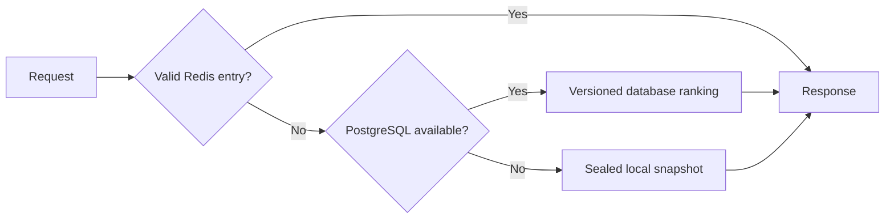

# PostgreSQL and Redis integration

The API now serves the sealed recommendation snapshot through PostgreSQL and
Redis. All **206,209 user rows** and **49,688 product rows** were compared with
the sealed artifacts. **135 project tests pass**, including six tests against a real
PostgreSQL instance. Live cache, outage, and recovery checks also pass.

## Request flow



Recommendation responses retain the evaluated ordering and fallback policy.
Successful misses populate Redis when available. Headers identify each route:

| Header | Values |
|---|---|
| `X-RecoMart-Cache` | `hit`, `miss`, `bypass` |
| `X-RecoMart-Source` | `redis`, `postgresql`, `snapshot` |

Product lookups use PostgreSQL with local fallback. Recommendation metadata
comes from the verified in-memory catalog. Database rows and cached rankings
are checked against the sealed snapshot before being served.

## Prepared local services

| Service | Address | Local storage |
|---|---|---|
| PostgreSQL 18 | `127.0.0.1:55432` | `.local/postgres` |
| Redis 8.8.0 | `127.0.0.1:56379` | WSL 1 distribution `RecoMartRedis` |
| FastAPI | `127.0.0.1:8000` | This repository |

The existing PostgreSQL service on port 5432 is untouched. Redis runs on Alpine
3.24.1 under WSL 1 because WSL 2 was unavailable on this machine. It runs as the
Linux `redis` user, binds to loopback, requires a password, and uses a 128 MB
memory limit with `allkeys-lru` eviction. Cache persistence is disabled.

Generated credentials are in `.local/services.json` and `.local/services.env`.
The entire `.local/` directory is ignored by Git. Do not commit these files.

From the repository root:

```powershell
.\.venv\Scripts\python.exe -m pip install -r requirements-api-lock.txt
.\.venv\Scripts\python.exe scripts/local_services.py start
.\.venv\Scripts\python.exe -m src.serving.import_snapshot --env-file .local/services.env
.\.venv\Scripts\python.exe -m uvicorn src.api.main:app --host 127.0.0.1 --port 8000 --env-file .local/services.env
```

The snapshot is already imported here; reimporting the same snapshot is
idempotent. If the API is already running, use it without launching a second
process on port 8000. Open [API docs](http://127.0.0.1:8000/docs) or
[health](http://127.0.0.1:8000/health).

These services do not automatically start after reboot. The helper starts or
stops only this workspace's prepared services; it is not an installer for a new
machine. To stop them:

```powershell
.\.venv\Scripts\python.exe scripts/local_services.py stop
```

Stop a foreground API with Ctrl+C. The helper expects PostgreSQL binaries under
`C:/Program Files/PostgreSQL/18/bin`; `RECOMART_POSTGRES_BIN` can override that
directory. Service launcher output is in `.local/service_control.log`.

## Configuration on another machine

Provide existing PostgreSQL and Redis instances using environment variables or
an explicitly loaded env file. See [`.env.example`](../.env.example).

| Variable | Meaning |
|---|---|
| `RECOMART_DATABASE_URL` | PostgreSQL connection URI for the published snapshot. |
| `RECOMART_REDIS_URL` | Redis URI, including `rediss://` for TLS when configured. |
| `RECOMART_CACHE_TTL_SECONDS` | Cache lifetime, 1-86400 seconds; default 3600. |
| `RECOMART_ARTIFACT_ROOT` | Optional root containing the sealed serving artifacts. |

Without backend URLs the API uses the local snapshot. A configured PostgreSQL
backend must be reachable and contain the matching snapshot at startup. A Redis
outage permits startup. After startup, backend outages fall back to the sealed
local snapshot and mark health as degraded while requests remain available.

The publisher needs schema creation and insertion privileges. The API pool uses
read-only PostgreSQL sessions. Local development shares one database role;
separate publisher and reader roles remain deployment work.

## Versioning and availability

The SQL migration records its checksum. Publication uses one transaction, COPY,
and an advisory lock so partial or concurrent imports cannot publish an
incomplete snapshot. Reimport checks existing metadata and row counts and does
not overwrite an existing version. The full smoke check separately verifies
row contents.

Database queries are pinned to the seal hash. Redis keys are
`recomart:v1:{snapshot_id}:user:{user_id}:k:{k}`; unknown users share user bucket
`0`, since they receive the same popularity ranking. Cached values contain no
requesting user identity. Version and K separation prevent reuse across
incompatible rankings. Invalid entries are discarded and recomputed.

Redis has bounded connection/read timeouts and a five-second retry cooldown.
PostgreSQL has a five-connection pool, bounded waits and statement timeouts, and
a five-second failure cooldown. Synchronous routes run through FastAPI's thread
pool. Each worker retains the full sealed snapshot for validation and outage
fallback; this integration does not reduce worker memory use. Switching
snapshots requires publication and a coordinated worker restart.

`/health` exposes `database` and `cache` as `disabled`, `ok`, or `unavailable`,
plus per-worker cache counters. Backend failures produce `status=degraded` and
`ready=true` when local fallback is available. Counters are process-local and
reset on restart.

## Verification

With the API and backends running:

```powershell
.\.venv\Scripts\python.exe -m src.api.backend_smoke --env-file .local/services.env
$recomartServices = Get-Content .local/services.json -Raw | ConvertFrom-Json
$env:RECOMART_TEST_DATABASE_URL = $recomartServices.database_url
.\.venv\Scripts\python.exe -m pytest tests -q -p no:cacheprovider
Remove-Item Env:RECOMART_TEST_DATABASE_URL
```

The test suite includes 30 API/store tests, 20 backend tests, sixteen demo tests, and six live
PostgreSQL tests. Without `RECOMART_TEST_DATABASE_URL`, the six live tests are
explicitly skipped. They create and remove their own randomly named test
databases; the test role needs permission to create databases.

The [backend smoke report](../results/benchmarks/backend_smoke.json) verifies
every published user and product row, a real PostgreSQL miss followed by a
Redis hit, expiration, and unknown-user fallback. No final-test labels are read.

The [HTTP smoke report](../results/benchmarks/api_database_http_smoke.json)
additionally verifies 100 recommendation requests, product lookup, unknown-user
fallback, input validation, and OpenAPI against the running integrated API.

The [outage report](../results/benchmarks/backend_outage_smoke.json) verifies
identical responses with Redis stopped, then with both backends stopped, and
successful recovery with Redis hits restored. To repeat that controlled local
test, which briefly stops this project's backends and restores them afterward:

```powershell
.\.venv\Scripts\python.exe scripts/check_local_outages.py
```

Implementation references: [Psycopg connection pools](https://www.psycopg.org/psycopg3/docs/advanced/pool.html)
and [Redis on Windows through WSL](https://redis.io/docs/latest/operate/oss_and_stack/install/archive/install-redis/install-redis-on-windows/).

## Next step

The [Streamlit demo](demo.md) is now connected to the API for shopper selection,
recommendations, catalog browsing, and visible fallback behavior. Reproducible
Docker Compose startup is documented in the [deployment guide](deployment.md).
Authentication, monitoring, and ingestion of new purchases remain separate work.
