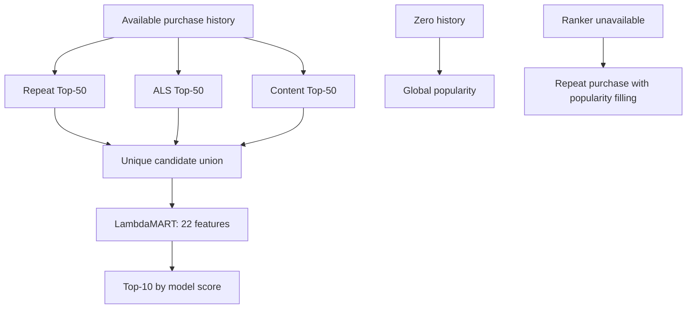

# Final architecture v1

**Follow-up:** the frozen refit and final-test evaluation are now complete; see
the [final-test report](final_test.md). This document records the decision and
protocol as they stood before test access.

## Frozen decision

**Repeat Purchase + ALS + Content candidates, followed by corrected LambdaMART
v1, with no forced discovery slots or aisle cap.** Keep the tested history and
availability fallbacks. Neural retrieval and discovery/diversity variants remain
documented experiments outside the selected pipeline.

The machine-readable contract is
[configs/final_architecture.json](../configs/final_architecture.json). It records
the selected model checksum, ordered features, parameters, candidate settings,
fallback behavior, reference source checksums, and the final-test protocol.



## Why three sources

The architecture comparison uses the same 41,114 ranker-validation users and
reproduces each saved uncapped benchmark. No retrievers or rankers are retrained
for this experiment.

| Candidate sources | Mean candidates/user | Recall@10 | NDCG@10 |
|---|---:|---:|---:|
| Repeat + ALS + Content | 106.37 | 0.354257 | 0.423541 |
| Three sources + TT-v1 | 129.28 | 0.354429 | 0.423779 |
| Three sources + both Two-Towers | 167.71 | 0.354390 | 0.423534 |

Before running the comparison, the engineering tolerance was set to **0.001
absolute Recall@10 and NDCG@10** (0.1 percentage points). A simpler architecture
qualifies only when its paired 95% lower bounds against every more complex
alternative stay within that tolerance for both metrics.

| Three-source difference versus | Recall difference [95% interval] | NDCG difference [95% interval] |
|---|---:|---:|
| Four sources | -0.000172 [-0.000645, +0.000264] | -0.000238 [-0.000603, +0.000126] |
| Five sources | -0.000133 [-0.000626, +0.000328] | +0.000007 [-0.000384, +0.000427] |

Three sources meet the declared tolerance and remove two neural retrieval
pipelines from the selected system. This is a measured complexity trade-off,
not a claim of identical models or higher accuracy. The tolerance applies to
aggregate metrics, not every user or history segment. For example, the selected
model has Recall@10 0.297305 for users with 1-2 orders, versus 0.298455 for the
five-source model.

The selected model was also rechecked against repeat-with-popularity fallback
in all four history segments. Its Recall and NDCG differences have positive
paired lower bounds in every segment, supporting the same availability routing
policy after architecture simplification.

## Diversity experiment

Tested policies allow at most 4, 3, or 2 products per aisle in Top-10. Selection
preserves model-score ordering among retained items. When the candidate pool
cannot provide ten products under the limit, the policy fills from the
highest-ranked skipped products and records the limit violation.

For the selected three-source model:

| Aisle cap | Recall@10 | NDCG@10 | Mean distinct aisles | Aisle-pair diversity | Catalog coverage |
|---|---:|---:|---:|---:|---:|
| None | 0.354257 | 0.423541 | 7.275 | 0.9044 | 45.41% |
| 4 | 0.353341 | 0.422886 | 7.360 | 0.9169 | 45.50% |
| 3 | 0.351167 | 0.421293 | 7.512 | 0.9300 | 45.70% |
| 2 | 0.344329 | 0.416187 | 7.993 | 0.9553 | 46.30% |

All caps increase category diversity but reduce Recall and NDCG; the selected
model's paired accuracy-loss intervals exclude zero for all three caps. Even the
mild cap of four loses 0.000916 recall, with interval [-0.001186, -0.000650].
The four- and five-source models show the same direction of accuracy trade-off.

The predeclared diversity gate requires increased aisle-pair diversity and
positive paired lower bounds for both accuracy changes. No cap passes. There is
no measured business preference or conversion benefit that would justify
accepting the accuracy loss here, so no cap becomes mandatory.

The cap cannot be met for 5, 10, and 34 users in the three-source pool at limits
4, 3, and 2 respectively. Every policy still returns ten recommendations.
Aisle-pair diversity is the fraction of distinct item pairs from different
aisles. It is a coarse category proxy; it does not measure semantic redundancy
or customer satisfaction. Actual basket composition is saved descriptively in
the benchmark, but baskets vary in size and are not directly comparable to fixed
Top-10 diversity values.

## Frozen settings

- Candidate sources: repeat purchase, implicit ALS (rank 64, alpha 5,
  regularization 0.05, ten iterations), and content preferences.
- Up to 50 products per source, deduplicated by user/product.
- Content retrieval: five preferred aisles, three preferred departments, up to
  100 products per aisle/department, department weight 0.5.
- LambdaMART: the 22-feature corrected v1 recipe; fixed **486 boosting rounds**
  for the final refit. Full parameters and ordered features are in the manifest.
- Top-10, ordered by score descending and product ID ascending for ties.
- No neural source, fixed fusion, forced novelty, dedicated discovery ranker, or
  mandatory category cap in the selected path.
- Positive history: selected ranker when available; otherwise repeat purchase
  with popularity filling. Zero history or no personalized source: popularity.

## Final-test protocol recorded at freeze time

This section preserves the protocol that was frozen before final-test access.
The completed final-test report now lives in [final_test.md](final_test.md);
these steps remain here to show exactly what was committed before labels were
opened:

1. Refit the selected ranker on all users' validation-basket labels, with
   candidate features generated from the original training history only.
   Preserve all positives, sample up to 15 negatives per user using the corrected
   negative-only hash ordering, and remove zero-positive training queries.
2. Use exactly 486 boosting rounds and the frozen parameters, without early
   stopping or a new hyperparameter search.
3. Advance the prediction history to **train + validation**. Rebuild item
   statistics, repeat history, ALS, content profiles, candidates, and ranking
   features from that pre-test history.
4. Generate and save predictions for the full 206,209-user cohort before opening
   final-test labels for metrics. Preserve the development artifacts separately.
5. Evaluate the selected system and the frozen baseline list using shared
   definitions: fixed-K precision, all eligible users, conditional repeat/novel
   metrics, and an explicit pre-test observed-catalog denominator.
6. Report that result without tuning architecture or parameters against the test.

The historical zero-history first-basket simulation stayed separate from this
known-user next-basket test. No final-test interactions were read when this
architecture decision was frozen.

## Reproduction and verification

```powershell
.\.venv\Scripts\python.exe -m pytest tests -q -p no:cacheprovider
.\.venv\Scripts\python.exe -m src.evaluation.diversity_architecture
```

- [Experiment runner](../src/evaluation/diversity_architecture.py)
- [Full results, segments, and paired intervals](../results/benchmarks/diversity_architecture.json)
- [Frozen architecture contract](../configs/final_architecture.json)
- Per-user metrics: `data/processed/diversity_architecture/user_metrics.parquet`
  (local, ignored by Git).

The full repository suite now has 135 passing tests with the live PostgreSQL
test configuration. The architecture-freeze subset covers cap semantics,
backfilling, category metrics, selection gates, and the earlier
evaluation/routing safeguards. Paired intervals use 2,000 user-bootstrap
samples, seed 42. They are development-cohort intervals conditional on fitted
models, with no correction for multiple comparisons or earlier
validation-driven selection. The independent final-test evaluation is complete
and reported separately.
